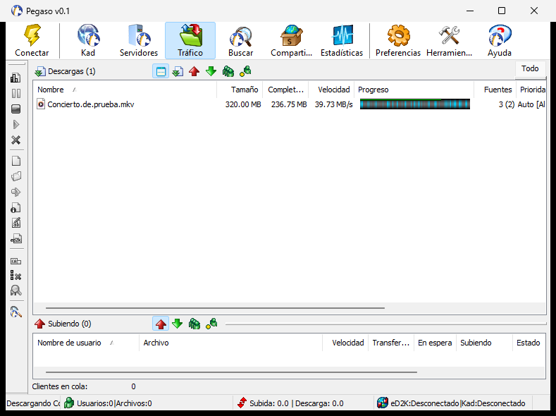

# Pegaso

**One program to download from eMule, BitTorrent and the web.** · [Español](README.md)

Pegaso is a free P2P client for Windows, derived from [eMule](https://www.emule-project.net) 0.72a (community edition). It keeps everything eMule does on the eD2K and Kad networks and adds BitTorrent, web downloads and several safety measures, all in the same download list.

## What it does

| | |
|---|---|
| **eMule networks** | eD2K servers and Kad, compatible with any eMule client. It ships with servers and starts Kad without any setup: just press **Connect**. |
| **BitTorrent** | Magnet links and `.torrent` files (libtorrent engine). File selection, piece map, seeding with a ratio limit, and web seeds. |
| **Web downloads** | HTTP and HTTPS with several connections per file, pause, and resume after closing the program. |
| **A single list** | The **Origin** column says where each download comes from: `E` eMule, `T` torrent, `W` web, or a mix such as `E+T+W`. |
| **Hybrid swarm** | One download can receive data from eMule sources, a web server and a torrent at the same time. Everything that arrives is checked against the eMule hashes. |
| **Fake detector** | The **Trust** column scores every search result and every download: it warns about a program named like a video, a file whose content does not match its extension, one file going around under unrelated names, or a torrent with a disguised program. It only warns; the decision is yours. |
| **File verdicts** | Whoever has a file can tell the others: correct, poor quality, fake, or not what the description says (for instance, the name says Spanish and it is in English). Files flagged by several users show up as suspicious. |
| **VPN protection** | Pegaso can be tied to a network adapter and cut all traffic if the VPN drops. |
| **Safety** | Every finished download is handed to the installed antivirus (AMSI) and marked as coming from the internet, as browsers do. |
| **Search on your own sites** | Keep a notebook of the sites you want to search: a search page (with `%s` where the words go) or a Torznab API such as the one of Jackett or Prowlarr. Pegaso lists the download links they return. It ships with no site at all. |
| **Making torrents** | Make the torrent of a file or folder of yours, with its magnet link, and seed it from where it is. |
| **Videos from the web** | A video published in an open format (HLS or DASH) is fetched choosing quality, language and file name. It takes neither encrypted videos nor those of platforms which hide them behind their player. See [docs/en/download-videos.md](docs/en/download-videos.md). |
| **Series of downloads** | `https://example.org/part[01-20].zip` fetches the twenty parts at once. |
| **Browser extension** | "Download with Pegaso" in the menu of Chrome, Edge and Firefox, for links, selections and, if you wish, the downloads of the browser. See [docs/en/browser-extension.md](docs/en/browser-extension.md). |
| **Renaming videos** | Gives finished videos the name of their film or series (`Name (year)`, `Name - 1x05`) with TheMovieDB, OMDb, TheTVDB, TVmaze or AniDB, and moves them to the folder you choose without ceasing to share them on eD2K or to seed them on BitTorrent. How to get the keys: [docs/en/rename-videos.md](docs/en/rename-videos.md). |
| **IPv6 and low IDs** | Calls directly over IPv6 whoever has a low ID but a public IPv6 address, and connects two low-ID clients through their routers (QUIC) when the server can introduce them. Compatible with eMule Qt, eMuleAI and aMule. |
| **Local API** | REST and MCP for scripts and AI assistants on the same computer: downloads, searches and connection. Off by default, with a secret key and on 127.0.0.1 only. See [docs/en/api.md](docs/en/api.md). |
| **Play while downloading** | A torrent is fetched in order and its video opens as soon as the beginning has arrived. |
| **Automatic folders** | A watched folder from which `.torrent` files and lists of links are added by themselves, and a folder for finished downloads by type, still shared. |
| **Import** | Goes on with the unfinished downloads of eMule and brings the torrents of qBittorrent with what they had. |
| **Scheduler** | Speed limits by time and day for every network, and a "Pause everything" action. |
| **Languages** | Spanish, English, French, Italian, Portuguese, German and Russian. |

## Installing

Download the installer of the [latest release](https://github.com/Draev-developer/Pegaso/releases/latest) and run it. It needs no administrator rights. The installer and the program follow the language of Windows; it can be changed in Preferences → General.

- Requirements: 64-bit Windows 10 or 11.
- The configuration is kept in `%LOCALAPPDATA%\Pegaso` and the downloads in the `Pegaso` folder inside Downloads. Uninstalling removes neither.
- Each release publishes the SHA-256 fingerprint of its installer: `certutil -hashfile Pegaso-<version>-setup.exe SHA256`.

## First steps

1. Press **Connect**. Pegaso joins an eD2K server and the Kad network.
2. Paste an `ed2k://` link, a `magnet:` link, a `.torrent` file or a web address to start a download.
3. **Preferences → Web and BitTorrent** holds the BitTorrent port, the connections per web download, the VPN protection and the privacy options.

To receive incoming connections (a high ID in eMule), Pegaso asks the router to open its ports (UPnP, NAT-PMP or PCP). If the router does not support that, open them by hand: they are the ones shown in **Preferences → Connection**. If the log warns that the router has no public address (CGNAT), only your provider can give you one.

### Hybrid swarm

Right-click an eMule download:

- **Add web source…**: an `http://` address where that same file is.
- **Add a torrent of this same file…**: a magnet link or `.torrent` file containing a file of exactly the same size. The window offers the ones Pegaso already knows — the torrents of the list and the `.torrent` files of your download folders — to pick it without typing anything.

The torrent only fetches what the download lacks. If its data does not pass the eMule check, it is not the same file and Pegaso drops it.

### File verdicts

Right-click a download or a shared file → **Rate this file…**. The verdict travels in the comment system of eMule, so eMule users see it too.

Torrents can be rated as well. BitTorrent has nothing of the kind, so Pegaso keeps those verdicts in the Kad network: other Pegaso users who add the same torrent see them, as long as they are connected to Kad.

## Privacy

Pegaso has no accounts and no telemetry, and your Windows name travels nowhere. As with every program of this kind, those you share with see your IP address: to hide it, Pegaso ties itself to your VPN and stops everything if it drops, or uses your proxy for everything that can go through it and does not send the rest. **Tools → Check my connection** shows which way each protocol leaves at that moment. Who sees what, what stays on your computer and the limits of each protection: [docs/en/privacy.md](docs/en/privacy.md).

## Responsible use

Pegaso is a file transfer tool. Use it only with content you have the right to download and share. The program neither includes nor links to content indexes.

## Contact

Pegaso grows with what its users ask for. If you miss something, something gets in your way or you have had an idea, write to **draev.pegaso@gmail.com**. The address is inside the program too, under "Contact".

On the networks: [X @draev_developer](https://x.com/draev_developer) · [Instagram draev.pegaso](https://www.instagram.com/draev.pegaso/)

## Building

The instructions are in [BUILDING.en.md](BUILDING.en.md). Visual Studio 2026 with the MFC component is required.

## Licence and credits

Pegaso is distributed under the **GNU General Public License, version 2** ([license.txt](license.txt)).

- It derives from **eMule** © 2002-2026 Merkur and the eMule team, starting from the community edition maintained by [irwir](https://github.com/irwir/eMule).
- BitTorrent through [libtorrent](https://libtorrent.org) (Arvid Norberg), with Boost and OpenSSL.
- Connections between low IDs through [ngtcp2](https://github.com/ngtcp2/ngtcp2) (QUIC); the formats of IPv6 and of those connections follow the specifications published by [eMule Qt](https://emule-qt.org).
- It also uses Crypto++, mbed TLS, miniupnpc, zlib, id3lib and ResizableLib.
- Country flags: address data from [IP Geolocation by DB-IP](https://db-ip.com) ("IP to Country Lite" database, CC BY 4.0 licence) and flag icons by Mark James (famfamfam.com, public domain).

The changes with respect to eMule 0.72a are in [CHANGELOG.en.md](CHANGELOG.en.md) and in the history of this repository.
