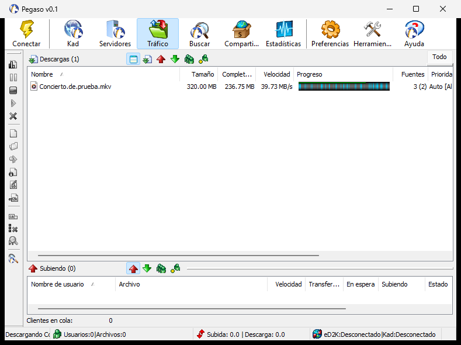
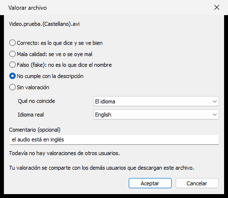

# Pegaso

**Un solo programa para descargar de eMule, BitTorrent y la web.**

Pegaso es un cliente P2P libre para Windows, derivado de [eMule](https://www.emule-project.net) 0.72a (edición de la comunidad). Conserva todo lo que hace eMule en las redes eD2K y Kad y añade BitTorrent, descargas web y varias medidas de seguridad, todo en la misma lista de descargas.

## Qué hace

| | |
|---|---|
| **Redes eMule** | Servidores eD2K y Kad, compatibles con cualquier cliente eMule. Trae servidores de serie y arranca Kad sin configuración: basta pulsar **Conectar**. |
| **BitTorrent** | Enlaces magnet y archivos `.torrent` (motor libtorrent). Selección de archivos, mapa de piezas, siembra con límite de ratio y semillas web. |
| **Descargas web** | HTTP y HTTPS con varias conexiones por archivo, pausa y reanudación tras cerrar el programa. |
| **Una sola lista** | La columna **Origen** dice de dónde viene cada descarga: `E` eMule, `T` torrent, `W` web, o una mezcla como `E+T+W`. |
| **Enjambre híbrido** | Una misma descarga puede recibir datos de fuentes eMule, de un servidor web y de un torrent a la vez. Todo lo que llega se comprueba con los hashes de eMule. |
| **Detector de falsos** | La columna **Confianza** puntúa cada resultado de búsqueda y cada descarga: avisa de un programa con nombre de vídeo, de un archivo cuyo contenido no corresponde a su extensión, de un mismo archivo que circula con nombres que no tienen que ver o de un torrent con un programa camuflado. Solo avisa; la decisión es del usuario. |
| **Marcador de archivos** | Quien tiene un archivo puede avisar a los demás: correcto, mala calidad, falso o no cumple la descripción (por ejemplo, el nombre dice español y está en inglés). Los archivos señalados por varios usuarios aparecen como sospechosos. |
| **Protección VPN** | Pegaso puede atarse a un adaptador de red y cortar todo el tráfico si la VPN se cae. |
| **Seguridad** | Cada descarga terminada se pasa al antivirus instalado (AMSI) y queda marcada como procedente de internet, igual que hacen los navegadores. |
| **Búsqueda en tus webs** | Guarda en una libreta las webs en las que quieres buscar: una página de búsqueda (con `%s` donde van las palabras) o una API Torznab como la de Jackett o Prowlarr. Pegaso lista los enlaces de descarga que devuelven. No trae ninguna web. |
| **Crear torrents** | Haz el torrent de un archivo o carpeta tuyos, con su enlace magnet, y siémbralo desde donde está. |
| **Descargas en serie** | `https://ejemplo.org/parte[01-20].zip` baja las veinte partes de una vez. |
| **Extensión de navegador** | «Descargar con Pegaso» en el menú de Chrome, Edge y Firefox, para enlaces, selecciones y, si quieres, las descargas del navegador. Ver [docs/extension-navegador.md](docs/extension-navegador.md). |
| **Renombrar vídeos** | Da a los vídeos terminados el nombre de su película o serie (`Nombre (año)`, `Nombre - 1x05`) con TheMovieDB, OMDb, TheTVDB, TVmaze o AniDB, y los mueve a la carpeta que elijas sin que dejen de compartirse en eD2K ni de sembrarse en BitTorrent. Cómo conseguir las claves: [docs/renombrar-videos.md](docs/renombrar-videos.md). |
| **IPv6 e ID bajas** | Llama directamente por IPv6 a quien tiene ID baja pero dirección IPv6 pública, y conecta a dos clientes con ID baja a través de sus routers (QUIC) cuando el servidor sabe presentarlos. Compatible con eMule Qt, eMuleAI y aMule. |
| **API local** | REST y MCP para scripts y asistentes de IA del mismo equipo: descargas, búsquedas y conexión. Desactivada de serie, con clave secreta y solo en 127.0.0.1. Ver [docs/api.md](docs/api.md). |
| **Idiomas** | Español, inglés, francés, italiano, portugués, alemán y ruso. |

## Instalación

Descarga el instalador de la [última versión](https://github.com/Draev-developer/Pegaso/releases/latest) y ejecútalo. No necesita permisos de administrador.

- Requisitos: Windows 10 u 11 de 64 bits.
- La configuración se guarda en `%LOCALAPPDATA%\Pegaso` y las descargas en la carpeta `Pegaso` dentro de Descargas. Desinstalar no borra ninguna de las dos.

## Primeros pasos

1. Pulsa **Conectar**. Pegaso entra en un servidor eD2K y en la red Kad.
2. Pega un enlace `ed2k://`, un enlace `magnet:`, un archivo `.torrent` o una dirección web para empezar una descarga.
3. En **Preferencias → Web y BitTorrent** están el puerto de BitTorrent, las conexiones por descarga web y la protección VPN.

Para recibir conexiones entrantes (ID alta en eMule), Pegaso pide al router que abra sus puertos (UPnP, NAT-PMP o PCP). Si el router no lo admite, ábrelos a mano: son los que aparecen en **Preferencias → Conexión**. Si el registro avisa de que el router no tiene dirección pública (CGNAT), solo tu operador puede darte una.

### Enjambre híbrido

Con el botón derecho sobre una descarga de eMule:

- **Añadir fuente web…**: dirección `http://` donde está ese mismo archivo.
- **Añadir un torrent de este mismo archivo…**: enlace magnet o archivo `.torrent` que contenga un archivo de exactamente el mismo tamaño.

El torrent solo baja lo que a la descarga le falta. Si sus datos no pasan la comprobación de eMule, no es el mismo archivo y Pegaso lo descarta.

### Marcador de archivos

Botón derecho sobre una descarga o un archivo compartido → **Valorar este archivo…**. La valoración viaja por el sistema de comentarios de eMule, así que también la ven los usuarios de eMule.

También se pueden valorar los torrents. BitTorrent no tiene nada parecido, así que Pegaso guarda esas valoraciones en la red Kad: las ven los demás usuarios de Pegaso que añadan el mismo torrent, siempre que estén conectados a Kad.

## Privacidad

Pegaso no tiene cuentas, telemetría ni avisos automáticos, y tu nombre de Windows no viaja a ninguna parte. Como en todo programa de este tipo, quien comparte contigo ve tu dirección IP: para ocultarla, Pegaso se ata a tu VPN y lo detiene todo si se cae, o usa tu proxy para todo lo que puede pasar por él y no envía lo demás. Qué ve cada cual, qué queda en tu equipo y los límites de cada protección: [docs/privacidad.md](docs/privacidad.md).

## Uso responsable

Pegaso es una herramienta de transferencia de archivos. Úsala solo con contenidos que tengas derecho a descargar y compartir. El programa no incluye ni enlaza índices de contenidos.

## Contacto

Pegaso crece con lo que piden quienes lo usan. Si echas algo en falta, algo te estorba o se te ha ocurrido una idea, escribe a **draev.pegaso@gmail.com**. La dirección está también dentro del programa, en el apartado «Contacto».

En las redes: [X @draev_developer](https://x.com/draev_developer) · [Instagram draev.pegaso](https://www.instagram.com/draev.pegaso/)

## Compilar

Las instrucciones están en [BUILDING.md](BUILDING.md). Hace falta Visual Studio 2026 con el componente MFC.

## Licencia y créditos

Pegaso se distribuye bajo la **Licencia Pública General de GNU, versión 2** ([license.txt](license.txt)).

- Deriva de **eMule** © 2002-2026 Merkur y el equipo de eMule, a partir de la edición de la comunidad mantenida por [irwir](https://github.com/irwir/eMule).
- BitTorrent mediante [libtorrent](https://libtorrent.org) (Arvid Norberg), con Boost y OpenSSL.
- Conexiones entre ID bajas mediante [ngtcp2](https://github.com/ngtcp2/ngtcp2) (QUIC); los formatos de IPv6 y de esas conexiones siguen las especificaciones publicadas por [eMule Qt](https://emule-qt.org).
- También usa Crypto++, mbed TLS, miniupnpc, zlib, id3lib y ResizableLib.
- Banderas de país: datos de direcciones [IP Geolocation by DB-IP](https://db-ip.com) (base «IP to Country Lite», licencia CC BY 4.0) e iconos de banderas de Mark James (famfamfam.com, dominio público).

Los cambios respecto a eMule 0.72a están en [CHANGELOG.md](CHANGELOG.md) y en el historial de este repositorio.

---

## English

Pegaso is a free P2P client for Windows derived from eMule 0.72a (community edition). It keeps everything eMule does on the eD2K and Kad networks and adds BitTorrent (magnet links and `.torrent` files, via libtorrent), multi-connection HTTP/HTTPS downloads, hybrid downloads (one file fed by eMule sources, a web server and a torrent at once, verified with the eD2K hashes), file verdicts (correct / poor quality / fake / does not match its description), VPN binding with a kill switch, an antivirus check of finished downloads, and a torrent search through user-configured Torznab providers.

Download the installer from the [latest release](https://github.com/Draev-developer/Pegaso/releases/latest). Windows 10/11, 64-bit. Licensed under the GNU GPL v2; see [BUILDING.md](BUILDING.md) to build it from source. Suggestions are welcome at draev.pegaso@gmail.com. On X: [@draev_developer](https://x.com/draev_developer); on Instagram: [draev.pegaso](https://www.instagram.com/draev.pegaso/).
